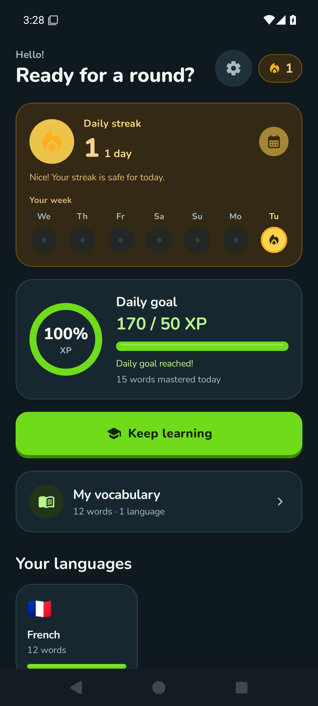
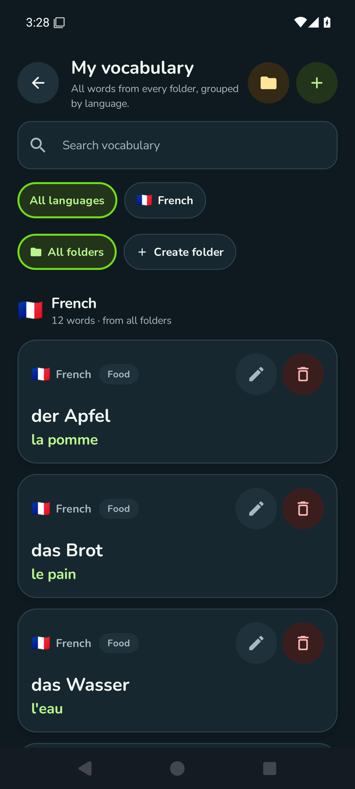
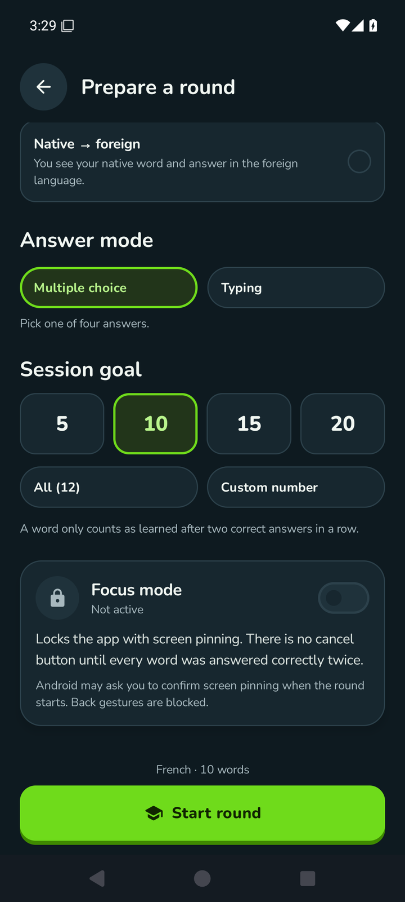
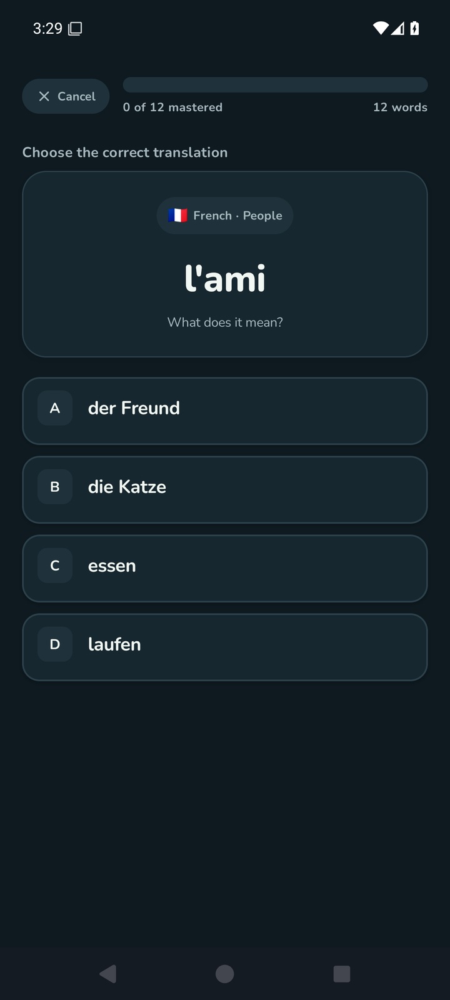
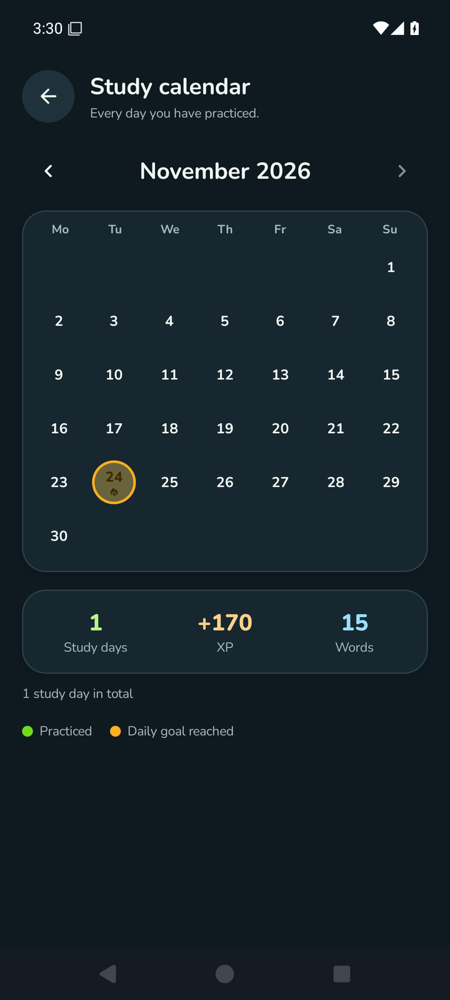
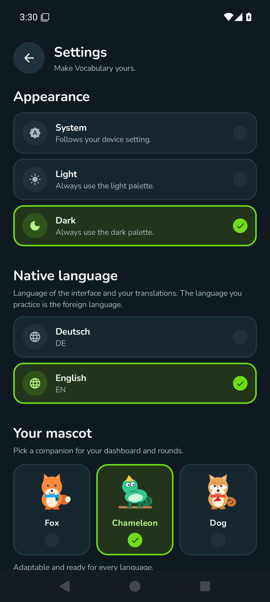

<div align="center">



# Vocabulary

**A calm, gamified vocabulary trainer for Android.**

Build your own word library, organize it into folders, and practice in four
different ways — completely offline.

[**Download the latest beta**](https://github.com/Natrium11-sudo/vocabulary-android/releases/latest) ·
[Screenshots](#screenshots) ·
[Build from source](#build-from-source)


</div>

## Why Vocabulary?

Vocabulary is a personal Android project built around a simple idea: learning
words should feel like a small daily win, not another inbox to clear.

The app combines a friendly, game-like interface with a practical word library:

- **Every folder in one view.** The vocabulary area groups all words by
  language and shows every folder in the same list, with folder labels on each
  card. Choose “All languages” to see the complete collection, or filter down to
  one language and still see all of its words across folders.
- **Four study modes.** Practice in either direction, as multiple choice or by
  typing the translation yourself.
- **A real mastery rule.** A word counts as learned only after two correct
  answers in a row.
- **Streaks and a study calendar.** See today’s goal, the current week and every
  day you have practiced.
- **Focus mode.** Pin the quiz to the screen until every word is mastered.
- **Offline and private.** No account, ads, analytics, or internet permission.

## Screenshots

| Dashboard | All vocabulary, across folders |
| :---: | :---: |
|  |  |
| **Prepare a round** | **Multiple-choice quiz** |
|  |  |
| **Study calendar** | **Settings and mascots** |
|  |  |

The screenshots use the English interface and a dark color palette. The app also
ships with a complete German interface and light/system themes.

## Features

### Vocabulary library

- Add, edit and delete native/foreign word pairs.
- Group words into named folders such as a test date or a topic.
- Search across native text, foreign text, language, category and folder name.
- Filter by language and folder.
- See all words of a language across every folder in one grouped area.
- Deleting a folder keeps its words: they simply become unfiled.

### Learning modes

Practice direction and answer format are chosen independently:

| Direction | Multiple choice | Typing |
| :--- | :---: | :---: |
| Foreign → native | Yes | Yes |
| Native → foreign | Yes | Yes |

Typing accepts minor differences in capitalisation, whitespace and accents.
Each session has a goal of 5, 10, 15 or 20 words, **all** available words (for
example a whole folder), or any custom number between 2 and the number of
available words.

### Mastery and progress

- A word needs **two correct answers in a row** to be mastered.
- A wrong answer resets that word’s progress and reveals the correct solution.
- Correct answers earn XP; a perfect round adds a bonus.
- The daily goal is 50 XP.
- The dashboard shows the streak, the current week, today’s XP and mastered
  words.

### Study calendar

Tap the streak card to open a Monday-to-Sunday monthly calendar:

- green days were practiced;
- a golden flame means the daily goal was reached;
- monthly stats show study days, XP and mastered words;
- arrow buttons navigate through months, with a “Today” shortcut.

All practice days are stored locally, so the calendar is not limited to the
current year.

### Make it yours

- **Theme:** system, light or dark.
- **Native language:** German or English for the interface and the native side
  of each word.
- **Mascot:** fox, chameleon or dog, each drawn in Compose Canvas code.

The language you practice is labelled as the **foreign language** in the study
setup. Saved vocabulary is never machine-translated or overwritten when the
interface language changes.

### Focus mode

Focus mode uses Android screen pinning (`startLockTask()`):

- there is no cancel button;
- system Back is intercepted;
- the task is released automatically only after every word has been mastered.

This mode is optional and can be enabled per round.

### Accessibility

- semantic labels for controls and icons;
- 48 dp touch targets;
- progress is conveyed by text and shape, not colour alone;
- scalable typography;
- responsive layout for wide screens.

## Tech stack

| Layer | Choice |
| :--- | :--- |
| Language | Kotlin 2.0 |
| UI | Jetpack Compose, Material 3 |
| Navigation | Navigation Compose |
| Persistence | Room 2.6 with a non-destructive 1 → 2 migration |
| Architecture | MVVM, unidirectional state, manual dependency container |
| Async | Kotlin Coroutines and Flow |
| Build | Gradle 8.9, Android Gradle Plugin 8.7.3, KSP |

The learning engine is free of Android dependencies, which keeps the core rules
unit-testable without an emulator.

## Project structure

```text
app/src/main/java/com/wortschatz/app/
├── data/
│   ├── local/              Room entities, DAOs and database
│   ├── repository/         Vocabulary, folder and progress repositories
│   └── SettingsStore.kt    Theme, interface language and mascot
├── domain/
│   ├── model/              Word pairs, folders, progress, calendar models
│   ├── progress/           Streak and week calculations
│   ├── session/            Learning modes, question engine and mastery rules
│   └── settings/           App language, theme and mascot enums
├── ui/
│   ├── calendar/           Monthly study calendar
│   ├── components/         Buttons, cards, mascots, progress and inputs
│   ├── dashboard/          Streak, daily goal and language overview
│   ├── library/            Word library, editor and folder management
│   ├── result/             Session summary and confetti
│   ├── session/            Setup, quiz and focus-mode handling
│   ├── settings/           Appearance, language and mascot settings
│   ├── theme/              Colours, typography and Material 3 theme
│   └── LocalizedApp.kt     In-app interface language switching
├── AppContainer.kt
├── MainActivity.kt
└── WortschatzApplication.kt
```

The Android application ID is `com.wortschatz.app`; the public product name is
**Vocabulary**.

## Build from source

### Requirements

- Android Studio with Android SDK 35
- JDK 17 or newer
- An Android device or emulator running Android 8.0 (API 26) or newer

### Build and test

```bash
git clone https://github.com/Natrium11-sudo/vocabulary-android.git
cd vocabulary-android

./gradlew :app:assembleDebug
./gradlew :app:testDebugUnitTest
./gradlew :app:lintDebug
```

The debug APK is written to:

```text
app/build/outputs/apk/debug/app-debug.apk
```

### Build the public beta APK

```bash
./gradlew :app:assembleRelease
adb install -r app/build/outputs/apk/release/app-release.apk
```

The beta release in this repository is signed with the local Android **debug**
key so it can be installed directly from GitHub. It is not intended for Google
Play. No signing key, keystore password or local SDK path is stored in this
repository.

### First launch

The first launch inserts a small starter deck of 32 French, Spanish and English
words so a round can begin immediately. The seed only runs when the database is
empty; deleting the sample words will not bring them back. All user data stays in
the local Room database.

## Privacy

Vocabulary has no internet permission, accounts, ads, analytics or cloud sync.
Words, folders, settings and progress are stored locally with Room. Android’s
own device-backup settings may include app data if the user enables backup in
the system settings.

## Beta notes

This is the second public beta (`1.0.0-beta.2`). It adds flexible session goals
(5/10/15/20 words, every available word, or a custom number) and puts the
project under the MIT license.

Known limitations:

- beta APK signed with a development key, not a production key;
- interface available in German and English only;
- no audio pronunciation;
- no CSV/JSON import or export yet;
- no sync between devices.

Feedback and bug reports are welcome through GitHub Issues. This is a personal
project, so pull requests are not being accepted at the moment.

## Tests

```bash
./gradlew :app:testDebugUnitTest
```

The repository currently contains 15 unit tests covering:

- streak and week calculations;
- the two-correct-answers mastery rule;
- question generation in both directions;
- typing tolerance;
- folder-only distractor handling;
- session summary maths.

## License

Vocabulary is released under the **MIT License**. See [`LICENSE`](LICENSE).

---

Built with Kotlin, Jetpack Compose and a lot of small daily wins.
